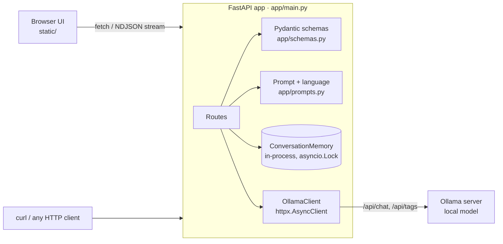

# Local LLM Chat API

A self-hosted, bilingual (English/Bangla) chat service that puts a FastAPI backend and a browser UI in front of a local [Ollama](https://ollama.com/) model. Conversations never leave the machine: there are no third-party API calls and no API keys.

It is built for developers who want a small, readable reference for serving a local LLM behind a typed HTTP API, with token streaming, per-session context, conversation export, health checks, tests and a one-command Docker setup.


## Features

- **Two chat modes:** a single JSON response (`POST /api/chat`) or a token stream as newline-delimited JSON (`POST /api/chat/stream`).
- **Session context:** each `session_id` keeps its history; the most recent `MAX_CONTEXT_MESSAGES` (default 20) are sent back to the model on every turn.
- **Language handling:** `auto`, `bn` or `en`. In `auto` mode the response language is resolved from the presence of Bengali-script characters in the message, and a bilingual system prompt is used.
- **Any installed Ollama model:** the default comes from configuration and can be overridden per request with `model`.
- **Conversation export** as JSON or Markdown, with filenames sanitised from the session ID.
- **Input validation with Pydantic:** message length 1–8,000 characters, blank messages rejected, session IDs limited to letters, digits, `-` and `_`.
- **Operational endpoints:** liveness (`/health/live`) and readiness (`/health/ready`, which checks Ollama is reachable); upstream failures return HTTP 503 instead of a stack trace.
- **Dependency-free web UI** (plain HTML/CSS/JavaScript) served by the same app, plus auto-generated Swagger docs at `/docs`.

## Architecture



**Request flow for a chat turn**

1. The request body is validated against `ChatRequest`.
2. The last *N* messages for the session are read from `ConversationMemory`.
3. A system prompt is chosen from the requested language, and `[system, …history, user]` is sent to Ollama.
4. For streaming, the server emits a `meta` event, then one `token` event per chunk, then `done` (or `error`). The full answer is stored only once the stream completes.

Shared objects (settings, memory, the HTTP client) are created in FastAPI's `lifespan` hook and the HTTP client is closed on shutdown.

## Tech stack

| Area | Tools |
|---|---|
| API | FastAPI, Uvicorn, Pydantic v2 |
| LLM runtime | Ollama (default model `llama3.2:3b`) via `httpx` async client |
| Frontend | HTML, CSS, vanilla JavaScript |
| Testing | pytest, FastAPI `TestClient` with a fake Ollama client |
| Packaging | Docker (non-root user, health check), Docker Compose, Makefile |

## Project structure

```text
Local_LLM_Chat_API/
├── app/
│   ├── main.py        # Routes, streaming, export, lifespan wiring
│   ├── config.py      # Settings read from environment variables
│   ├── ollama.py      # Async Ollama client and error wrapper
│   ├── memory.py      # Per-session conversation store
│   ├── prompts.py     # System prompts and language resolution
│   └── schemas.py     # Request/response models
├── static/            # Browser chat UI
├── tests/             # API, memory and prompt tests
├── Dockerfile
├── docker-compose.yml # ollama + model-loader + app
├── Makefile
├── requirements.txt
├── requirements-dev.txt
└── .env.example
```

## Quick start with Docker (recommended)

Requires Docker Engine with Compose (or Docker Desktop).

```bash
git clone https://github.com/hasansust32/Local_LLM_Chat_API.git
cd Local_LLM_Chat_API
cp .env.example .env
docker compose up --build
```

Compose starts three services: `ollama`, a one-off `model-loader` that pulls the configured model, and `app`, which waits for the pull to finish. The first run downloads `llama3.2:3b` and can take several minutes.

| URL | What |
|---|---|
| http://localhost:8000 | Chat UI |
| http://localhost:8000/docs | Swagger / OpenAPI docs |
| http://localhost:11434 | Ollama API |

Stop with `Ctrl+C`, then `docker compose down`. Model files persist in the `ollama_data` volume; `docker compose down -v` removes them.

To use a different model:

```bash
OLLAMA_MODEL=qwen2.5:3b docker compose up --build
```

## Running without Docker

1. Install Ollama, pull a model and start the server:

   ```bash
   ollama pull llama3.2:3b
   ollama serve
   ```

2. In a second terminal (Python 3.10+; the Docker image uses 3.12):

   ```bash
   python -m venv .venv
   source .venv/bin/activate          # Windows: .venv\Scripts\activate
   pip install -r requirements.txt
   export OLLAMA_BASE_URL=http://localhost:11434
   uvicorn app.main:app --reload
   ```

The app reads configuration from environment variables only. It does **not** load `.env` itself; that file is consumed by Docker Compose. When running locally, export the variables you need, as above.

## Configuration

| Variable | Default | Description |
|---|---|---|
| `OLLAMA_BASE_URL` | `http://localhost:11434` | Ollama server URL (`.env.example` uses `http://ollama:11434` for Compose) |
| `OLLAMA_MODEL` | `llama3.2:3b` | Default model when a request does not set `model` |
| `OLLAMA_TIMEOUT_SECONDS` | `120` | Read timeout for Ollama calls (connect timeout is fixed at 10 s) |
| `MAX_CONTEXT_MESSAGES` | `20` | How many recent messages are sent as context |
| `APP_NAME` | `Local LLM Chat` | Application name setting |

Invalid or non-positive numeric values fall back to the defaults.

## API reference

No authentication is implemented; see [Engineering considerations](#engineering-considerations).

| Method | Endpoint | Description |
|---|---|---|
| `POST` | `/api/chat` | Complete response as JSON |
| `POST` | `/api/chat/stream` | Token stream (`application/x-ndjson`) |
| `GET` | `/api/models` | Installed Ollama models and the configured default |
| `GET` | `/api/sessions/{session_id}` | Stored messages for a session |
| `DELETE` | `/api/sessions/{session_id}` | Clear a session (204) |
| `GET` | `/api/sessions/{session_id}/export?format=json\|markdown` | Download the conversation |
| `GET` | `/health/live` | Process is up |
| `GET` | `/health/ready` | Ollama is reachable (503 otherwise) |

**Request body** for both chat endpoints:

```json
{
  "message": "Explain FastAPI in two sentences",
  "session_id": "demo",
  "language": "en",
  "model": "llama3.2:3b"
}
```

Only `message` is required. If `session_id` is omitted, a new one is generated and returned.

**Non-streaming example**

```bash
curl -X POST http://localhost:8000/api/chat \
  -H 'Content-Type: application/json' \
  -d '{"message":"বাংলায় FastAPI বুঝিয়ে বলো","language":"auto"}'
```

Response shape:

```json
{
  "session_id": "3f2c…",
  "model": "llama3.2:3b",
  "language": "bn",
  "message": {
    "role": "assistant",
    "content": "…",
    "created_at": "2026-01-01T12:00:00Z"
  }
}
```

**Streaming example**

```bash
curl -N -X POST http://localhost:8000/api/chat/stream \
  -H 'Content-Type: application/json' \
  -d '{"message":"Write a two-line poem","session_id":"demo","language":"en"}'
```

Each line is one JSON event:

```text
{"type": "meta", "session_id": "demo", "model": "llama3.2:3b", "language": "en"}
{"type": "token", "content": "Morning"}
{"type": "token", "content": " light…"}
{"type": "done"}
```

**Errors**

| Status | When |
|---|---|
| 422 | Request body fails validation (e.g. blank message, invalid `session_id`) |
| 400 | Unsupported export `format` |
| 503 | Ollama unreachable, timed out or returned an empty reply |

During streaming the HTTP status is already 200, so upstream failures arrive as `{"type": "error", "detail": "…"}`.

## Testing

```bash
pip install -r requirements-dev.txt
python -m pytest
```

The six tests cover the chat and streaming endpoints, Markdown export, the memory window and language resolution. They replace Ollama with a fake client, so no model or network access is needed.

> Use `python -m pytest`. Running bare `pytest` (and therefore `make test`) currently fails with `ModuleNotFoundError: No module named 'app'`, because `pyproject.toml` does not add the project root to `pythonpath`.

## Engineering considerations

- **State:** conversation memory lives in process RAM. It is lost on restart and is not shared between multiple Uvicorn workers or containers. A Redis or PostgreSQL-backed implementation of the same `ConversationMemory` interface would be the next step for multi-instance use.
- **Concurrency:** memory access is guarded by an `asyncio.Lock`; Ollama calls use a single shared async HTTP client.
- **Security:** there is no authentication, rate limiting or CORS configuration, and Ollama's port is published by Compose. Run it on a trusted network or put it behind a reverse proxy with authentication before exposing it.
- **Container hardening:** the image runs as a non-root user and defines a Docker `HEALTHCHECK` against `/health/live`.
- **Model quality:** responses depend entirely on the chosen local model; no evaluation of answer quality, latency or token usage is included.
- **Logging:** no structured application logging is configured beyond Uvicorn's access log.

## Future improvements

- Persistent memory backend (Redis/PostgreSQL) behind the existing interface.
- API-key or OAuth authentication and per-client rate limiting.
- Request logging with latency and token counts returned by Ollama.
- Configure `pythonpath` in `pyproject.toml` and add a GitHub Actions workflow running the tests.
- Optional retrieval (RAG) over local documents.

## License

[MIT](LICENSE)

## Author

**S M Mahamudul Hasan** · [GitHub](https://github.com/hasansust32) · [Portfolio](https://www.hasansm.com/) · [LinkedIn](https://www.linkedin.com/in/sm-mahamudul-hasan/)
